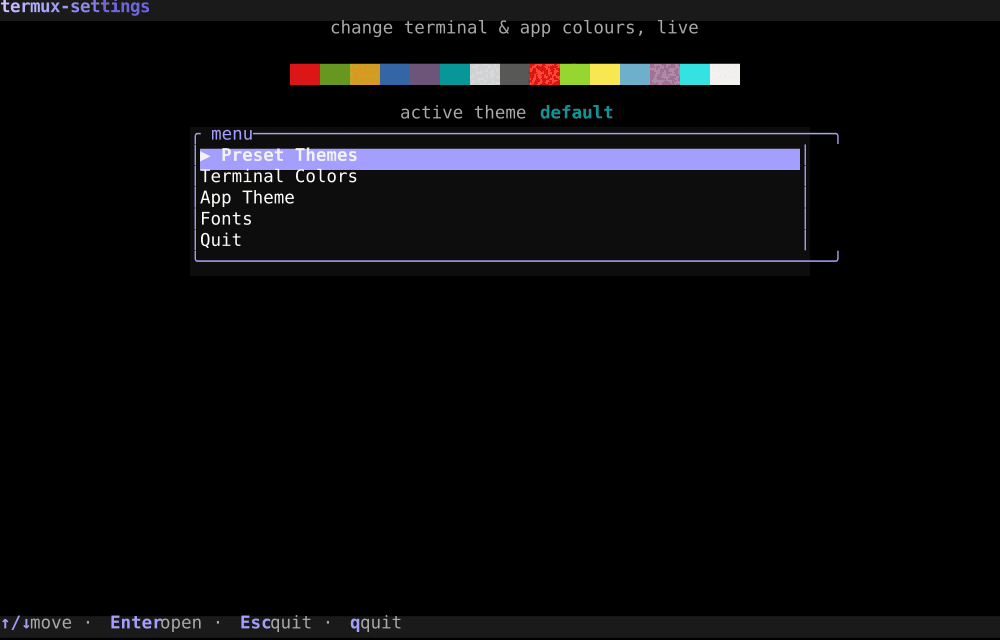

# termux-settings

[](https://github.com/GeneralKaos666/termux-settings/actions/workflows/ci.yml)
[](https://github.com/GeneralKaos666/termux-settings/releases/latest)
[](https://crates.io/crates/termux-settings)
[](https://docs.rs/termux-settings)
[](https://codecov.io/gh/GeneralKaos666/termux-settings)
[](LICENSE)

A keyboard-driven TUI for [Termux](https://termux.dev) that changes your
terminal colours, your Termux app theme, and your fonts.



```
termux-settings
change terminal & app colours, live

▮▮▮▮▮▮▮▮▮▮▮▮▮▮▮▮
active theme  default

╭─ menu ──────────────────────╮
│ ▶ Preset Themes             │
│   Terminal Colors           │
│   App Theme                 │
│   Fonts                     │
│   Quit                      │
╰─────────────────────────────╯
↑/↓ move · Enter open · Esc quit · Ctrl+C quit
```

The title is a fixed lavender→indigo gradient, pane borders and highlights use
a violet accent, and every screen shows a context-sensitive help bar along the
bottom.

## Features

- **Themes itself from your palette**: the TUI re-colours itself to match the
  active terminal theme, and updates live as you highlight presets.
- **Preset Themes**: browses the themes in `~/.termux/colors/` (the same
  library used by `colors.sh`), with a filter box, a mock shell session
  rendered in each theme, a swatch grid, and a colour strip. Activating a theme
  points `~/.termux/colors.properties` at it and runs `termux-reload-settings`.
- **Terminal Colors**: edits background, foreground, cursor and the 16 ANSI
  colours with inline swatches, live validation and a live preview. Save in
  place or `Save As...` a new theme.
- **App Theme**: edits a safe subset of `~/.termux/termux.properties`
  (`use-black-ui`, cursor style, margins, transcript rows, etc.) in sectioned
  groups, without touching anything it does not manage.
- **Fonts**: browses the fonts in `~/.termux/fonts/`, previews each one against
  a real shell prompt, and applies it to a slot (`regular`, `bold`, `italic`,
  `bold-italic`); can also import files and download Nerd Fonts.
- **Safe by default**: before overwriting an existing config it asks whether
  to write a timestamped backup to `~/.termux/backups/`.

## Requirements

- Termux with a truecolor (24-bit colour) terminal. Termux always has one; a
  terminal that only supports 256 colours will render approximated colours.
- `termux-reload-settings` (from `termux-tools`) for live reloading.
- At least a 40×10 terminal; smaller windows show a notice instead of the UI.

## Install

### APT (recommended)

`termux-settings` is available from the [termux-apt-repo](https://github.com/GeneralKaos666/termux-apt-repo) repository.

```sh
mkdir -p "$PREFIX/etc/apt/keyrings"
curl -fsSL https://generalkaos666.github.io/termux-apt-repo/key.gpg \
  -o "$PREFIX/etc/apt/keyrings/termux-apt-repo.gpg"
echo "deb [signed-by=$PREFIX/etc/apt/keyrings/termux-apt-repo.gpg] https://generalkaos666.github.io/termux-apt-repo stable main" \
  > "$PREFIX/etc/apt/sources.list.d/termux-apt-repo.list"
pkg update && pkg install termux-settings
termux-settings
```

### Release package (.deb)

Each release also ships a `.deb` for 64-bit (`aarch64`) and 32-bit (`arm`)
devices. Download both the package and its `.sha256` from the
[releases page](https://github.com/GeneralKaos666/termux-settings/releases), then
install the one matching `uname -m`:

```sh
pkg install ./termux-settings_*_aarch64.deb
```

Use `termux-settings_*_arm.deb` when `uname -m` prints `armv7l`. The packages
install to `$PREFIX/bin`, so `pkg remove termux-settings` uninstalls them.

### Release binary

Download the asset that matches your device and install it as
`$PREFIX/bin/termux-settings`:

```sh
pkg install curl
curl -LO https://github.com/GeneralKaos666/termux-settings/releases/latest/download/termux-settings-aarch64-linux-android
install -m 755 termux-settings-aarch64-linux-android "$PREFIX/bin/termux-settings"
```

Use `termux-settings-armv7-linux-androideabi` instead on 32-bit devices
(`uname -m` prints `armv7l`). Each release also ships a `.sha256` file:

```sh
curl -LO https://github.com/GeneralKaos666/termux-settings/releases/latest/download/termux-settings-aarch64-linux-android.sha256
sha256sum -c termux-settings-aarch64-linux-android.sha256
```

### crates.io

The crate is published as [`termux-settings`](https://crates.io/crates/termux-settings).
This needs a Rust toolchain on the device, so the APT and `.deb` paths above
are faster unless you already build Rust on Termux:

```sh
pkg install rust
cargo install termux-settings
```

### From source

Rust 1.88.0 or newer is required (let-chains and the patched `time` release
both need 1.88).

```sh
pkg install rust git
git clone https://github.com/GeneralKaos666/termux-settings.git
cd termux-settings
cargo build --release
install -m 755 target/release/termux-settings "$PREFIX/bin/termux-settings"
```

### Upgrading from the Python version

Remove the old entry point first:

```sh
pip uninstall termux-settings
```

Otherwise the Python script in `$PREFIX/bin` keeps shadowing the new binary.
Your themes, `termux.properties` edits and backups are untouched by the
upgrade.

## Usage

```sh
termux-settings
```

Every screen shows a context-sensitive help bar along the bottom with its exact
keys. The common ones:

| Key | Action |
| --- | --- |
| `↑` / `↓` (or `j` / `k`) | move the selection, or previous/next field |
| `←` / `→` | cycle a selector's choices (App Theme) |
| `Tab` / `Shift+Tab` | next / previous focus region or field |
| `Home` / `End` | first / last item |
| `PageUp` / `PageDown` | jump ten items |
| `Enter` | activate the focused item or button |
| `Esc` | go back; quits from the main menu |
| `q` / `Ctrl+C` / `Ctrl+Q` | quit from anywhere, including dialogs |
| `Ctrl+S` | save (editors) |
| `Ctrl+A` | save as a new theme (Terminal Colors) |
| `Ctrl+R` | revert unsaved edits (editors) |
| `r` | reload the theme library (Preset Themes) |
| `d` | delete the selected theme (Preset Themes; refuses the active one) |
| `R` | rename the selected theme (Preset Themes) |
| `p` / `Space` | preview the selected font into the current slot (Fonts) |
| `s` | cycle the font slot (Fonts) |
| `i` | import a font file (Fonts) |
| `d` | open the Nerd Font catalog to download a font (Fonts) |
| `/` | filter the list (Fonts) |

In Preset Themes, `Tab` focuses the filter box; type to search the library. In
Fonts, `/` opens the same kind of filter (matched against the font's name,
family and style); `Esc` clears it, then leaves the screen.

### Command line

```sh
termux-settings --help                     # print usage and exit
termux-settings                            # launch the TUI
termux-settings --list-fonts               # list fonts in ~/.termux/fonts/
termux-settings --apply-font FiraCode       # install a font to a slot
termux-settings --apply-font FiraCode --slot bold
termux-settings --list-themes               # list themes in ~/.termux/colors/
termux-settings --apply-theme dracula       # activate a theme
termux-settings --list-backups              # list ~/.termux/backups/
termux-settings --restore-backup colors-2026-10-25-123456.properties
termux-settings --version                  # print the version
termux-settings --ascii                    # plain-ASCII glyphs
```

`--slot` takes `regular`, `bold`, `italic`, or `bold-italic` (default
`regular`). `--apply-theme` accepts either the library label (`group/theme`) or
the bare theme name, ignoring case. `--restore-backup` takes the file name that
`--list-backups` prints and writes it back over the config file it came from,
making one backup of the current file first. `--ascii` (or
`TERMUX_SETTINGS_ASCII=1`) swaps the Unicode glyphs for plain-ASCII equivalents
everywhere — pane and dialog borders, the selection markers, and the help bar;
the legacy `TERMUX_COLORS_ASCII` and `FONT_CHANGER_ASCII` variables are still
honoured.

Exit codes: `--list-fonts` exits `1` when the font library exists but cannot be
read; `--apply-font` with an unknown name, `--apply-theme` with an unknown
theme, `--restore-backup` with an unknown or path-like name, or `--slot` with an
unknown slot, exits `2`. Unknown options, unexpected arguments and options
missing their value are usage errors and also exit `2`. Any other error exits
`1`.

## Relationship to `colors.sh`

`termux-settings` reads the same library as `~/.termux/colors.sh`
(`~/.termux/colors/<group>/*.properties`) and activates themes the same way:
by symlinking `~/.termux/colors.properties` and calling
`termux-reload-settings`. The two can be used interchangeably. If the library
is empty, a small set of built-in themes is written to
`~/.termux/colors/builtin/`.

`termux.properties` is edited line-by-line, so complex settings such as
`extra-keys`, background images and comments are left untouched.

The on-disk formats, `colors.sh` interoperability and backup behaviour are the
same as the previous version.

## Development

Rust 1.88.0 or newer; `1.88.0` is the toolchain CI tests, so a feature that
needs anything newer needs a `rust-version` bump in `Cargo.toml` first.
`rust-toolchain.toml` pins that toolchain (with `rustfmt` and `clippy`) for
contributors who use `rustup`.

```sh
pkg install rust
cargo test
```

Lint before committing:

```sh
cargo fmt --check
cargo clippy --all-targets -- -D warnings
cargo deny check          # licenses, duplicates and sources (install: cargo install cargo-deny)
```

Coverage is not a gate, but CI measures it on every pull request:

```sh
cargo llvm-cov --all-targets --summary-only
```

Tests point the app at a temporary directory through the `TERMUX_HOME`
environment variable, so they never touch your real config. The TUI lifecycle
(raw mode and the alternate screen) is exercised once by
`sh tests/scripts/tui_smoke_test.sh target/debug/termux-settings`, which needs a
built binary and `script`.

## Backups

Backups are plain copies named `colors-YYYY-MM-DD-HHMMSS.properties`,
`termux-YYYY-MM-DD-HHMMSS.properties`, or `<font-slot>-YYYY-MM-DD-HHMMSS.ttf`
under `~/.termux/backups/`. The ten newest backups of each kind are kept; older
ones are pruned after a new backup is written.

Use `--list-backups` to see them, newest first, and `--restore-backup <name>` to
put one back. A restore backs up the current file before overwriting it, so the
restore itself can be undone.

## Contributing

The workflow, commit rules and test seams are in
[`CONTRIBUTING.md`](CONTRIBUTING.md). The module map is in
[`docs/structure.md`](docs/structure.md), designs and plans live under
`docs/specs/` and `docs/plans/`, and security reports go through
[`SECURITY.md`](SECURITY.md).
